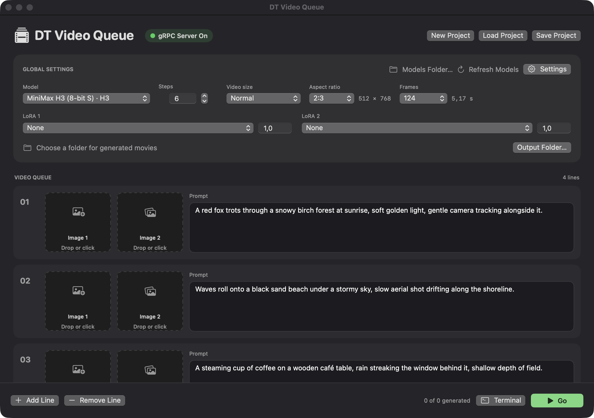

# DT Video Queue

A native SwiftUI macOS app that queues videos using Draw Things’ gRPC server. The videos will be generated one by one.

## Run

A prebuilt `DT Video Queue.app` is included in this repository (Apple Silicon, macOS 14+). It is ad-hoc signed and not notarized, so on first launch macOS may block it; allow it in **System Settings → Privacy & Security → Open Anyway**. macOS may also ask to let the app access data from other apps; allow it so the app can read Draw Things' model list. To build it yourself, run `./scripts/build-app.sh`. In Draw Things, enable **API Server → gRPC**, set port **7859**, and enable **TLS**. Keep Draw Things open. The app defaults to `127.0.0.1:7859`; change the host, port, or TLS setting in **Settings**. Shared Secret must be disabled for this connection.

The app reads installed H3/LTX models and compatible LoRAs from Draw Things’ model JSON registries. If macOS blocks folder access, use **Models Folder…** to select `~/Library/Containers/com.liuliu.draw-things/Data/Documents/Models`. The server must have the selected files installed; the app checks them before generation.

Add prompts and optional **Image 1**/**Image 2** reference images, choose the global settings and output folder, then press **Go**. Videos run sequentially. Image 1 is sent as the primary image tensor; Image 2 is sent as the first `shuffle` (moodboard) hint, and requires Image 1. Exact endpoint conditioning depends on the selected model; the H3 FL2VA model supports both. Reference images are scaled and center-cropped to the chosen dimensions.

The server streams frames and optional generated audio. The app writes H.264 `.mov` movies using macOS AVFoundation, preserving generated audio. The global **Frames** selector defaults to 124 and offers H3-valid counts: 1, or 5–362 in increments of 17 (5, 22, 39, …, 362). The adjacent duration is frames divided by 24 FPS for H3, or 25 FPS for LTX. The selected count is sent to the server and saved with projects; older projects default to 124. H3 audio uses 32 kHz; LTX 2 uses 24 kHz and LTX 2.3 uses 48 kHz.

Video Size sets the long side to 1152 (Large), 768 (Normal), 576 (Small), or 384 (Very Small). Aspect Ratio selects 2:3, 1:1, or 3:2. The calculated dimensions appear beside the selector. Older projects with “Extra Small” remain compatible.

Project JSON includes model/LoRA selections, strengths, size, aspect ratio, steps, server settings, output folder, prompts, and image paths. **New Project** clears the queue while keeping global settings. The app follows the macOS light/dark appearance. It creates no log files; **Terminal** displays connection, sampling, export progress, and errors in memory. Temporary movie/audio files are removed after export or a handled failure.

## Generation optimizations

Settings includes **Sol Attention** (enabled, Start Step 2, Tau 0.50) and **TeaCache** (enabled, Start Step 5, End Step 6, Threshold 0.06, Max Skip Steps 3). These are global settings, retained by New Project and saved in project JSON. Older projects receive these defaults. Every gRPC request explicitly includes all eight values, including the enable flags. Draw Things applies them when supported by the selected model. The Terminal view shows the values submitted for each video.

## Verification

`swift test -c release --scratch-path /private/tmp/dt-video-queue-build` checks configuration encoding, protobuf parsing, tensor decompression, project compatibility, and native movie export with audio. `DT_QUEUE_CHECK_SERVER=1 swift test -c release --scratch-path /private/tmp/dt-video-queue-build` additionally checks the server using **Echo only**, without generating media. The direct-client rewrite has not been tested with another generation request.

Protocol reference: [Draw Things imageService.proto](https://github.com/drawthingsai/draw-things-community/blob/main/Libraries/GRPC/Models/Sources/imageService/imageService.proto). Third-party license notices are bundled with the app.
